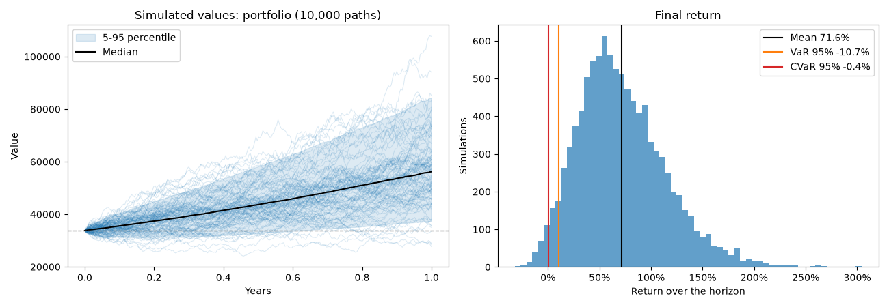
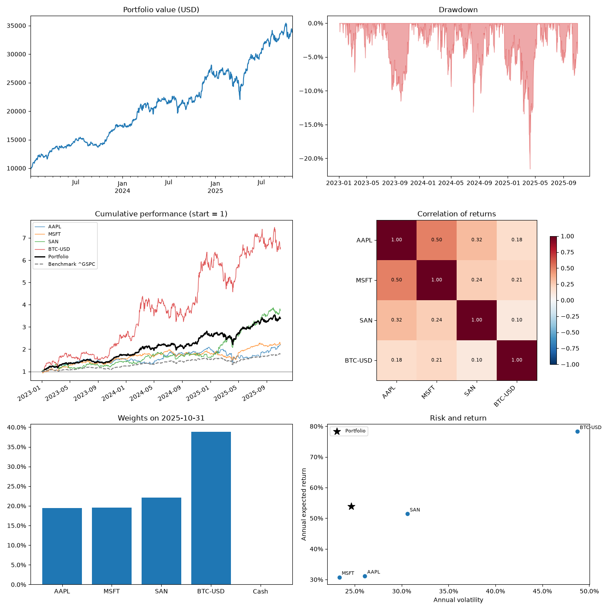
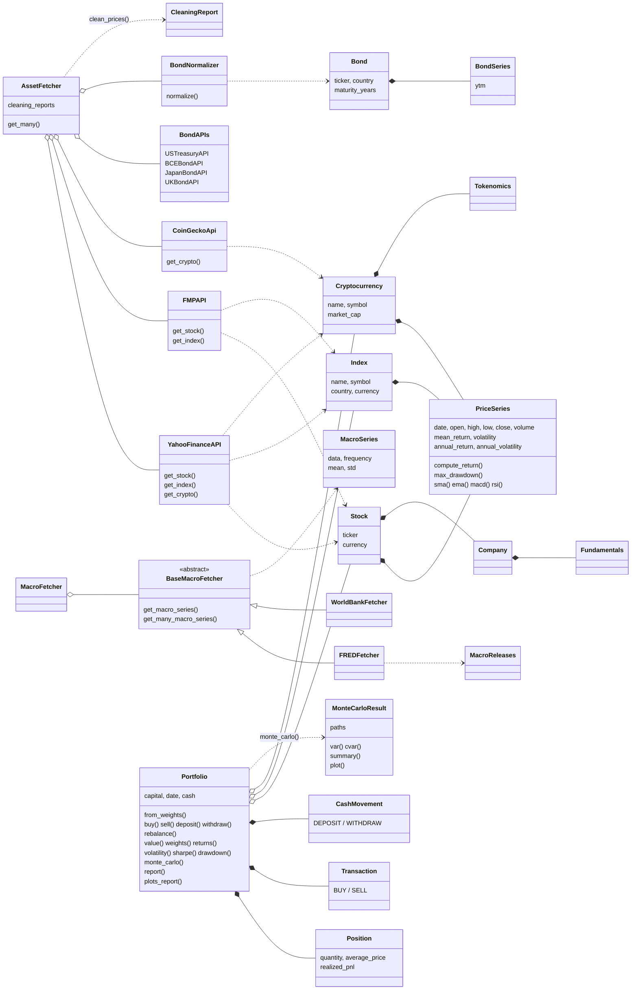
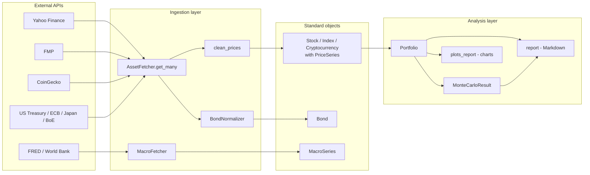

# Financial Toolkit

Python toolkit to download, standardize and analyse market data, and to build,
simulate and report investment portfolios.

The ingestion layer (one fetcher per API) is decoupled from the analysis layer
(price series, portfolio, Monte Carlo, reports): every source returns the same
internal dataclasses, so a new API or a new analysis can be added without
touching the core.

## Features

| Area | What it does |
|---|---|
| Stocks and indices | Historical prices from **Yahoo Finance** and **Financial Modeling Prep** (FMP), returned as the same `Stock` / `Index` objects |
| Cryptocurrencies | Prices from **Yahoo Finance** or **CoinGecko**, returned as `Cryptocurrency` |
| Fundamentals | Income statement, balance sheet and cash flow history of each company (Yahoo, FMP) |
| Interest rates | Government bond yields from the US Treasury, ECB, Japan MoF and Bank of England, normalized into `Bond` |
| Macroeconomics | FRED and World Bank series (`MacroSeries`) and FRED release vintages (`MacroReleases`) |
| Batch download | `AssetFetcher.get_many()` downloads N assets of any type and source from one list; `MacroFetcher.get_many_macro_series()` does the same for macro series |
| Cleaning | Missing values, duplicates, time zones and outliers, with a `CleaningReport` per asset |
| Price series | `PriceSeries` dataclass with mean, volatility and annualized statistics computed on creation, plus returns, drawdown, SMA, EMA, MACD, RSI and Bollinger bands |
| Portfolio | Long/short positions, transactions, deposits and withdrawals, rebalancing, value, weights, returns, volatility, Sharpe, correlations and drawdown |
| Monte Carlo | Simulation of the portfolio or of one asset with configurable simulations, horizon, return and volatility (historical by default), with VaR, CVaR and a plot of paths and distribution |
| Reports | `Portfolio.report()` in Markdown and `Portfolio.plots_report()` with six analytical charts |

## Project structure

```
Financial-Toolkit/
├── main.py                  # End-to-end demo
├── src/financial_toolkit/   # Installable package
│   ├── apis/                # Adapters for each external source (Yahoo, FMP, CoinGecko, bonds, FRED, World Bank)
│   ├── ingestion/           # AssetFetcher and MacroFetcher facades, bond normalizer and price cleaning
│   ├── models/              # Standard dataclasses: price series, assets, fundamentals, bonds, macro
│   ├── analysis/            # Portfolio, positions, transactions, cash movements and Monte Carlo
│   ├── enums.py
│   └── exceptions.py
├── tests/                   # Notebooks that test each part with known cases and real data
├── examples/                # Output of main.py (report and plots)
├── pyproject.toml           # Package metadata and dependencies (uv / pip)
├── requirements.txt         # Pinned dependencies exported from uv.lock
├── uv.lock
└── .env.example             # API keys template
```

## Prerequisites

- Python 3.12 or newer.
- Internet access (all data is downloaded from public APIs).
- Optional free API keys, only for these sources:

| Variable | Needed for | Get it at |
|---|---|---|
| `FMP_API_KEY` | Financial Modeling Prep | https://site.financialmodelingprep.com/developer/docs |
| `COINGECKO_API_KEY` | CoinGecko (demo key) | https://www.coingecko.com/en/api |
| `FRED_API_KEY` | FRED macro series | https://fred.stlouisfed.org/docs/api/api_key.html |

Yahoo Finance, the bond sources and the World Bank need no key, so the demo
runs without any.

## Installation

1. Clone the repository:

   ```bash
   git clone https://github.com/hugoballesterom/Financial-Toolkit.git
   cd Financial-Toolkit
   ```

2. Install the package and its dependencies. With [uv](https://docs.astral.sh/uv/):

   ```bash
   uv sync
   ```

   Or with pip:

   ```bash
   python -m venv .venv
   source .venv/bin/activate        # Windows: .venv\Scripts\activate
   pip install -r requirements.txt
   pip install -e .
   ```

3. Optional: copy the keys template and fill in the keys you have:

   ```bash
   cp .env.example .env
   ```

## Quick start

```bash
python main.py                       # or: uv run main.py
```

The demo downloads Apple, Microsoft, Santander (NYSE ADR), Bitcoin and the
S&P 500 for 2023-01-03 to 2025-10-31, builds a 10,000 USD portfolio
(30/30/20/20), simulates one year with 10,000 paths and saves to `examples/`:

- [`portfolio_report.md`](examples/portfolio_report.md): the Markdown report.
- `monte_carlo.png` and `plots_report.png`:




## Usage

### Download assets from any source

```python
from financial_toolkit import AssetFetcher, YahooFinanceAPI

# One asset from one API.
apple = YahooFinanceAPI().get_stock("AAPL", period="5y")
msft = YahooFinanceAPI().get_stock("MSFT", period="5y")
sp500 = YahooFinanceAPI().get_index("^GSPC", start="2020-01-01")
bitcoin = YahooFinanceAPI().get_crypto("BTC-USD", period="2y")

# N assets of different types and sources in one call, already trimmed and cleaned.
fetcher = AssetFetcher()
assets = fetcher.get_many(
    [
        {"type": "stock", "api": "yfinance", "symbol": "AAPL"},
        {"type": "stock", "api": "fmp", "symbol": "MSFT"},       # needs FMP_API_KEY
        {"type": "index", "api": "yfinance", "symbol": "^IBEX"},
        {"type": "crypto", "api": "coingecko", "symbol": "bitcoin"},  # needs COINGECKO_API_KEY
        {"type": "bond", "api": "us_treasury", "symbol": "US10Y"},
    ],
    start="2025-01-01",
    end="2025-10-31",
)
fetcher.cleaning_reports["AAPL"]   # CleaningReport: rows dropped, outliers, time zone...
```

Accepted combinations: `stock` and `index` with `yfinance` or `fmp`, `crypto`
with `yfinance` or `coingecko`, and `bond` with `us_treasury`, `bce`, `japan`
or `uk`.

### Price series statistics

```python
prices = apple.price            # PriceSeries
prices.mean_return, prices.volatility             # per period, computed on creation
prices.annual_return, prices.annual_volatility    # annualized
prices.max_drawdown(), prices.rsi(), prices.macd(), prices.bollinger_bands()
```

### Macro data

```python
from financial_toolkit import MacroFetcher

macro = MacroFetcher()
unemployment = macro.get_macro_series("UNRATE", source="FRED", start="2020-01-01")
gdp = macro.get_many_macro_series(
    ["NY.GDP.MKTP.CD", "FP.CPI.TOTL.ZG"], source="WB", country="ES"
)
```

### Portfolio, Monte Carlo and reports

```python
from financial_toolkit import Portfolio

portfolio = Portfolio.from_weights(
    assets=[apple, msft, bitcoin],
    weights={"AAPL": 0.4, "MSFT": 0.4, "BTC-USD": 0.2},
    capital=10_000,
    date="2023-01-03",
)
portfolio.buy(apple, 5, "2024-03-01")
portfolio.deposit(1_000, "2024-06-03")

portfolio.value(), portfolio.weights(), portfolio.sharpe(risk_free=0.04)

# Monte Carlo of the whole portfolio or of one asset.
simulation = portfolio.monte_carlo(n_simulations=10_000, years=2, seed=1)
simulation.summary()        # mean, median, VaR, CVaR, loss probability
simulation.plot()

single = portfolio.monte_carlo(5_000, years=1, asset="BTC-USD")

# Own assumptions instead of the historical estimates (annual, log returns).
stressed = portfolio.monte_carlo(10_000, years=5, annual_return=0.03, annual_volatility=0.35)

# Markdown report (returned as text and optionally saved) and plots.
text = portfolio.report(
    sections=("summary", "assets", "monte_carlo", "warnings"),
    risk_free=0.04,
    monte_carlo=simulation,
    max_weight=0.4,
    path="report.md",
)
portfolio.plots_report(benchmark=sp500)
```

In a notebook the plots are shown directly; in a script call
`matplotlib.pyplot.show()`.

## Design decisions

### Standardized output

Each API has its own fetcher, but all of them return the same dataclasses:
`Stock`, `Index` and `Cryptocurrency` hold a `PriceSeries` (OHLCV indexed by
date), and every bond source goes through `BondNormalizer` to return a `Bond`
with a `BondSeries`. The analysis layer only knows these objects, never the
raw API responses.

### Input validation: strict on purpose

The toolkit does **not** accept any object that happens to contain a time
series. `Portfolio`, `Transaction` and `Position` only accept `Stock`, `Index`
and `Cryptocurrency`, and every price series is validated:

- dates must be valid and unique, and prices positive and finite;
- at most 5% of the closes may be invalid (see cleaning below);
- weights, quantities, capital and dates are type checked and must be finite;
- operations must be chronological, and only USD is supported until currency
  conversion is implemented.

A permissive input (any DataFrame or Series) would let wrong data reach the
metrics silently: yields treated as prices, returns treated as prices, mixed
currencies, unsorted or duplicated dates. A portfolio built on that would give
plausible but wrong numbers. Failing early with a clear message is cheaper
than a wrong risk report, and the extra cost is small because every source
already returns the internal objects.

### Data cleaning

`clean_prices()` is applied by `AssetFetcher` to every downloaded price series:

- **Missing values**: rows with a missing, infinite or non-positive close are
  dropped, not filled, because filling would invent prices and false zero
  returns. If more than **5%** of the closes are invalid the series is
  rejected, as it is not reliable enough to work with. The same 5% rule is
  applied to bond yields. Macro series keep their NaN values, because a
  missing macro observation (for example a year without data in the World
  Bank) is information, not a broken record.
- **Duplicates and time zones**: repeated timestamps keep the last row, and
  dates are converted to the exchange's local date without time zone.
- **Outliers**: counted (returns beyond 5 standard deviations) but **never
  changed**. In finance extreme returns are usually real, and removing them
  would understate risk. They appear in the `CleaningReport` and as a warning
  in `Portfolio.report()` so the user can check they are not data errors.

### Calendar alignment

Assets trade on different calendars (crypto every day, stocks on business
days, different holidays per exchange). `Portfolio` uses two views:

- **Valuation** uses a daily calendar, carrying the last close of stocks and
  indices forward.
- **Risk metrics and Monte Carlo** use only the dates on which every asset has
  an observed price. Filling weekends would add false zero returns and lower
  the volatility.

### Bonds

Bonds are downloaded as yield series, not prices, so they cannot be held in a
portfolio (`Portfolio` rejects them). Fixed income enters a portfolio through
bond ETFs (for example `IEF` or `TLT`) downloaded as stocks, and the yields
are used as interest rate data.

## Architecture

### Classes



### Data flow



## Tests

The `tests/` folder holds one notebook per part, each with known cases, error
cases and real data:

| Notebook | Covers |
|---|---|
| `pruebas_yahoo_finance_tests.ipynb` | Yahoo stocks, prices and fundamentals |
| `comparacion_yahoo_fmp_tests.ipynb` | Yahoo vs FMP: same objects from both APIs |
| `test_indices.ipynb`, `test_indices_fmp.ipynb` | Indices from Yahoo and FMP |
| `test_coingecko_tests.ipynb` | CoinGecko cryptocurrencies |
| `bond_test.ipynb` | The four bond sources |
| `macro_test.ipynb` | FRED and World Bank |
| `portfolio_validation.ipynb` | Portfolio accounting, flows and metrics |
| `monte_carlo_test.ipynb` | Monte Carlo against known parameters |

Open them with the project's environment as kernel (`uv sync` installs
`ipykernel`).

## Troubleshooting

- **`ModuleNotFoundError: No module named 'financial_toolkit'`**: the package
  is not installed in the active environment. Run `uv sync` or
  `pip install -e .`. On macOS, if the project is inside an iCloud-synced
  folder (such as `Documents`), the files in `.venv` can be marked as hidden
  and Python then ignores the editable install. Run
  `chflags -R nohidden .venv`, or create the environment outside iCloud.
- **`FMP_API_KEY is missing`, `COINGECKO_API_KEY is not configured`, or
  `FRED_API_KEY must be set`**: add the key to `.env` (see Prerequisites).
- **`Convert asset prices to USD before trading`**: the portfolio only accepts
  USD assets. Use the USD listing (for example `SAN` instead of `SAN.MC`).
